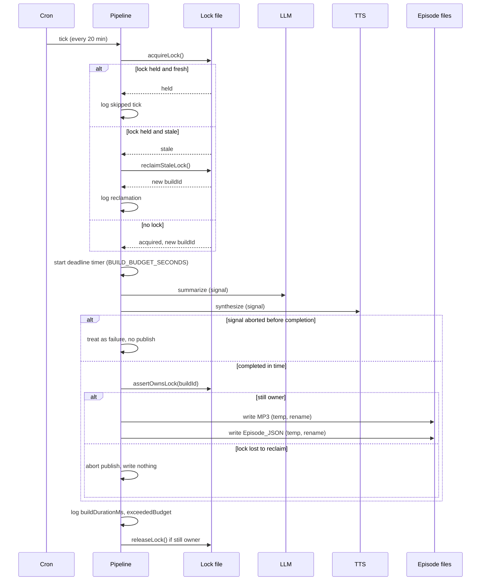

# Design Document

## Overview

The briefing-pipeline is a headless, cron-invoked batch job that turns the MIT News RSS feed into one spoken briefing per campus per day. It is organized as a chain of pure cores (normalize, select, length, grounding) wired together by a thin orchestration layer that handles I/O (fetch, LLM, TTS, disk) through adapters. The pipeline is the only writer of Episode files and imports nothing from the web player or telephony features (Requirement 10.6).

This design follows `docs/brief.md` and the steering files in `.kiro/steering/`. Where this design surfaces a tension with a frozen requirement, it is recorded in **Requirement contradictions found** near the end rather than changing `requirements.md`.

`docs/brief.md` states that the synthetic fixture (`content/fixtures/synthetic-3-items.xml`) and the property-based-testing boundary are shared across all three specs in the breakdown (briefing-pipeline, web-player, telephony). This pipeline is the only writer of that fixture's consuming test boundary; the other two specs read published Episode files, not the fixture.

## Architecture

```
scripts/build-briefing.ts  (cron entry point)
        │
        ▼
┌───────────────────────────────────────────────────────────────┐
│ Pipeline orchestration (src/pipeline/run.ts)                   │
│                                                                  │
│  1. acquire build lock (src/pipeline/lock.ts)                   │
│  2. ingest        (src/ingest/*)        ── adapter: http.ts     │
│  3. normalize     (src/ingest/normalize.ts)   ── pure            │
│  4. select        (src/select/select.ts)      ── pure            │
│  5. too-thin drop (src/select/too-thin.ts)    ── pure            │
│  6. summarize p1  (src/summarize/summarize.ts)── adapter: LLM    │
│  7. ground        (src/ground/ground.ts)      ── pure            │
│  8. drop failures                                                │
│  9. summarize p2 (only if 1 or 2 survivors)   ── adapter: LLM    │
│ 10. ground p2 survivors once                                     │
│ 11. length check  (src/length/length.ts)      ── pure            │
│ 12. assemble script (src/publish/assemble.ts) ── pure            │
│ 13. synthesize    (src/tts/tts.ts)            ── adapter: TTS    │
│ 14. measure duration (src/publish/duration.ts)── pure            │
│ 15. publish       (src/publish/publish.ts)    ── adapter: fs     │
│ 16. release lock, write build log line                           │
└───────────────────────────────────────────────────────────────┘
```

Layering matches `structure.md`: ingest → summarize → tts → publish, telephony and web read publish only, never the reverse. Pure cores (`normalize.ts`, `select.ts`, `length.ts`, `ground.ts`, `assemble.ts`, `duration.ts`, the Episode JSON codec) take no I/O, clock or random source as a parameter other than explicit values (e.g. `now`); this is what the property tests target.

```mermaid
flowchart LR
    Feed[MIT RSS Feed] -->|http.ts| Ingest
    Ingest --> Normalize[Normalizer<br/>A1 Tag_Stripper → B Entity_Decoder → A2 Whitespace_Normalizer]
    Normalize --> TooThin{len < 500?}
    TooThin -- drop --> Dropped1[dropped: too-thin]
    TooThin -- keep --> Select[Selector]
    Select --> Pass1[Summarize pass 1<br/>target 85w/story]
    Pass1 --> Ground1[Grounding check]
    Ground1 -- fail --> Dropped2[dropped: grounding-failed]
    Ground1 -- pass --> Survivors1{Survivor count}
    Survivors1 -- 3 or 0 --> Length
    Survivors1 -- 2 --> Pass2a[Re-summarize at 120w]
    Survivors1 -- 1 --> Pass2b[Re-summarize at 165w]
    Pass2a --> Ground2[Grounding check once]
    Pass2b --> Ground2
    Ground2 -- fail --> Dropped3[dropped: grounding-failed]
    Ground2 -- pass --> Length[Length_Module check]
    Length -- fail --> NoPublish[publish nothing]
    Length -- pass --> Assemble[Assemble script]
    Assemble --> TTS[TTS_Adapter: one MP3]
    TTS --> Duration[Measure MP3 duration]
    Duration -- below 60s or unmeasurable --> NoPublish
    Duration -- ok --> Publish[Publisher: write MP3 then Episode_JSON]
```



## Components and Interfaces

### Ingestor (`src/ingest/ingest.ts`)

```ts
type FeedItem = { guid: string; title: string; pubDate: string; contentEncoded: string };
type IngestError =
  | { kind: "fetch-failed"; message: string }
  | { kind: "parse-failed"; message: string };

function fetchFeed(feedUrl: string, http: HttpClient): Promise<Result<FeedItem[], IngestError>>;
```

- Uses `rss-parser` (already provisional in `tech.md`) through `src/lib/http.ts` only. `HTTP_RETRY_COUNT` retries are applied inside `http.ts`.
- Items missing `guid`, `pubDate` or `content:encoded`, or with an unparseable `pubDate`, are filtered out before being returned; their titles are logged by the caller (the Ingestor itself returns the valid items plus a list of skipped titles, since it performs no logging I/O itself — logging is done by the Pipeline, matching the pattern already required for the Entity_Decoder in 2.7).

```ts
type IngestResult = { items: FeedItem[]; skipped: { title: string; reason: "missing-field" | "bad-date" }[] };
function parseFeed(xml: string): Result<IngestResult, IngestError>;
```

### Normalizer (`src/ingest/normalize.ts`)

Three pure stages, composed in a fixed order. Each stage is a pure function; side data (unrecognised names, offsets) is returned, never logged internally — the Pipeline logs it.

```ts
type TagStripResult = {
  text: string;                      // output of stage A1
  unknownTagNames: string[];         // 2.14
  unclosedElements: { name: "script" | "style" | "comment"; offset: number }[]; // 2.15
};
function stripTags(input: string): TagStripResult;

type EntityDecodeResult = {
  text: string;                      // output of stage B
  unrecognisedEntities: string[];    // 2.6, 2.7
  invalidNumericRefs: string[];      // see "Entity table" below
};
function decodeEntities(input: string): EntityDecodeResult;

function normalizeWhitespace(input: string): string; // stage A2, idempotent

type NormalizeReport = {
  sourceText: string;                // Source_Text = A2(B(A1(content:encoded)))
  unknownTagNames: string[];
  unclosedElements: { name: "script" | "style" | "comment"; offset: number }[];
  unrecognisedEntities: string[];
  invalidNumericRefs: string[];
};
function normalize(contentEncoded: string): NormalizeReport;
```

`normalize` is the only composition point; it calls `stripTags` once, then `decodeEntities` once on `stripTags`'s output, then `normalizeWhitespace` once on `decodeEntities`'s output. It never feeds `decodeEntities` output back into `stripTags` (2.4, 2.9).

#### A1 — Tag_Stripper algorithm

Single left-to-right scan over the input string, one output buffer, no fixpoint iteration (confirmed: there is no "re-run until stable" loop anywhere in this design — see the Testing Strategy note on this).

```
i = 0
while i < len(input):
  if input[i] != '<':
    append input[i] to output; i += 1; continue

  # candidate tag start at i
  if startsWithCI(input, i, "<!--"):
    find "-->" starting search at i+4
    if found at j: i = j + 3   # comment and contents contribute nothing
    else: record unclosed("comment", i); i = len(input)   # drop to end of article
    continue

  name = readTagName(input, i)   # '<', optional '/', run of [A-Za-z0-9]+, case-insensitive
  if name is null:                # not a tag-shaped sequence at all (e.g. "5 < 6")
    append input[i]; i += 1; continue

  if name in {"script", "style"}:
    closeTag = findClosingTag(input, i, name)   # quote-aware search for </name>
    if found at j: i = j + len("</" + name + ">")   # element + contents contribute nothing
    else: record unclosed(name, i); i = len(input)  # drop to end of article
    continue

  closeAngle = findClosingAngle(input, i)   # quote-aware search for the matching '>'
  if closeAngle is null:
    append input[i]; i += 1       # '<' is literal; resume scanning at i+1
    continue

  if lower(name) in Known_Tag_Set:
    if lower(name) in Block_Tag_Set: append ' ' to output
    # else: known non-block tag contributes nothing
    i = closeAngle + 1
  else:
    append input[i..closeAngle] to output   # unknown tag-shaped text preserved literally
    record unknownTagName(name)
    i = closeAngle + 1
```

`findClosingAngle` and `findClosingTag` both skip over `'...'` and `"..."` spans (quote-aware), so a `>` or `<` inside an attribute value (e.g. `data-caption="a > b"`) never ends or starts a tag early (2.10). If a quote is unterminated, the scan reaches either the next unquoted `<` or end-of-input without finding the closing `>`; in that case the candidate `<` is literal (2.10's explicit fallback).

**Known_Tag_Set** (case-insensitive match on tag name, before attributes): `p, div, br, a, em, strong, b, i, code, span, sub, sup, cite, img, iframe, center, blockquote, h1, h2, h3, h4, h5, h6, ul, ol, li, table, tr, td, th, svg, path, g, script, style, section, article, figure, figcaption`.

**Block_Tag_Set** (subset of Known_Tag_Set, each contributes one space): `p, div, br, li, ol, ul, h1, h2, h3, h4, h5, h6, tr, td, th, table, blockquote, section, article, figure, figcaption, center`.

Both constants are declared once in `src/config/tags.ts` and Requirement 2.16 is enforced by a property test asserting `Block_Tag_Set ⊆ Known_Tag_Set`.

**Regression fixtures** (Requirement 14.7–14.10), each a literal test case in `ingest/normalize.test.ts`:

| Input | Expected `stripTags` output | Notes |
| --- | --- | --- |
| `<<b>b>` | `<b>` | first `<` has no `>` before the next `<`, so it is literal; `<b>` (inline, known, non-block) is then deleted, leaving the literal `<` immediately followed by `b>` — concretely the scan is: `<` literal (no close before next `<`), then `<b>` recognized and deleted (contributes nothing), leaving `b>` appended as plain text after the literal `<`, giving `<b>` as literal output text (not a real tag) composed of the preserved `<` plus the literal `b>` that followed the deleted inline tag. |
| `<p>end.</p><p>Next</p>` | `end. Next` (after full Normalizer) | adjacent block tags each contribute one space; words never merge |
| `<p>a</p><script>var x = 1;</script><p>b</p>` | `a b` | script element and contents contribute nothing, no extra space; `"var x"` absent |
| `x<y and y>z` | `x<y and y>z` unchanged | `y` is not in Known_Tag_Set, so the candidate tag at `<y...>` (closing `>` found at `y>`) is preserved literally as part of the unchanged text, and `y` is reported once via `unknownTagNames` |

Note on the `<<b>b>` row: this is the regression required by 14.7 precisely because it is "the smallest input that fails a fixpoint-iterating stripper and a single-pass-idempotence claim" — a stripper that re-scanned its own output could delete the literal `<` text `b>` as if it were a new tag. This design's single left-to-right pass never revisits output, so it cannot do that.

#### B — Entity_Decoder algorithm and pinned entity table

Single pass over `stripTags` output. At each `&`, attempt to match (in order): a numeric decimal reference `&#\d+;`, a numeric hexadecimal reference `&#[xX][0-9a-fA-F]+;`, or a named reference `&name;` against the pinned table. On no match, copy the `&` literally and advance one character (so a bare `&` or a malformed/unterminated reference is never dropped).

**Pinned named-entity table** (`src/config/entities.ts`):

| Entity | Decodes to |
| --- | --- |
| `&amp;` | `&` |
| `&lt;` | `<` |
| `&gt;` | `>` |
| `&quot;` | `"` |
| `&apos;` | `'` |
| `&nbsp;` | U+0020 (plain space) |
| `&mdash;` | — |
| `&ndash;` | – |
| `&lsquo;` | ‘ |
| `&rsquo;` | ’ |
| `&ldquo;` | “ |
| `&rdquo;` | ” |
| `&hellip;` | … |

- An unrecognised **named** reference (e.g. `&foo;`) is copied to the output exactly as written (including the `&` and `;`) and its name is added to `unrecognisedEntities` (2.6, 2.7).
- A **numeric** reference that is out of Unicode range (> `0x10FFFF`), a UTF-16 surrogate code point (`0xD800`–`0xDFFF`), or `0x0` (NUL) is treated as invalid: it is copied to the output exactly as written and its literal text is added to `invalidNumericRefs`, which the Pipeline logs the same way as unrecognised named entities. This guarantees no text is silently dropped for malformed numeric references, matching the "preserve and report" principle already required for unknown tags (2.14) and unknown named entities (2.6).
- Decoding happens in one left-to-right pass with no re-scan: the decoder never re-examines bytes it has already written to the output, so a decoded value that happens to look like another entity reference (e.g. a named entity whose expansion is the literal text `&amp;`) is not decoded a second time. This is the direct test for 2.8's "single pass" requirement — see Testing Strategy, property 4.
- `&nbsp;` decodes to a plain U+0020 space, not U+00A0, so that it is then collapsed by the Whitespace_Normalizer exactly like a literal space (this is what makes U+00A0-sourced-via-`&nbsp;` and a raw U+00A0 byte behave identically downstream, matching 2.2's intent; a raw literal U+00A0 byte that was never an entity reaches stage A2 unchanged and is also collapsed there, since 2.2 defines whitespace as including U+00A0).

#### A2 — Whitespace_Normalizer

```ts
function normalizeWhitespace(input: string): string {
  // treat U+0020, \t, \n, \r, \f, \v and U+00A0 as whitespace
  return input.replace(WHITESPACE_RUN_RE, " ").trim();
}
```

Pure, idempotent (`normalizeWhitespace(normalizeWhitespace(x)) === normalizeWhitespace(x)`), creates no new `<`-starting substring that was not already present in its input (it only replaces whitespace runs with a single space and trims the ends — a regex-based implementation of this is naturally incapable of introducing a `<`).

### Selector (`src/select/select.ts`)

```ts
type SelectionResult = {
  selected: FeedItem[];          // newest first, at most 3
  widened: boolean;
  coveredDates: string[];        // populated only when widened, in Campus_Timezone, YYYY-MM-DD
};
function select(items: FeedItem[], now: Date, campusTimezone: string): SelectionResult;
```

Algorithm: filter items with `pubDate <= now`. Try the 48-hour window first; if it yields 3 or more, take the 3 newest (tie-break by `guid` ascending on equal `pubDate`) and return `widened: false`. Otherwise widen to the 7-day window, take up to 3 newest with the same tie-break, set `widened: true`, and compute `coveredDates` as the sorted set of distinct campus-local calendar dates among the widened selection's `pubDate`s. If nothing falls within 7 days, return an empty selection with `widened: false` (there is nothing to widen to-date-cover, since nothing was selected).

`select` takes `now` as a parameter and never reads the system clock (3.1); the Pipeline passes `new Date()` at the call site.

### Length_Module (`src/length/length.ts`)

```ts
const STORY_COUNT_TO_BUDGET: Record<1 | 2 | 3, number> = { 3: 290, 2: 275, 1: 200 };

function wordCount(text: string): number;              // splits on whitespace runs
function isAcceptableLength(totalWords: number, finalStoryCount: 1 | 2 | 3): boolean;
  // true iff 150 <= totalWords <= STORY_COUNT_TO_BUDGET[finalStoryCount]
```

Pure; no I/O, clock or randomness (8.6). `wordCount` splits on `/\s+/` after trimming, so `wordCount(a + " " + b) === wordCount(a) + wordCount(b)` for non-empty `a`, `b` with no leading/trailing whitespace (8.7).

### Grounding_Checker (`src/ground/ground.ts`)

```ts
type Token = { kind: "number" | "date" | "name"; raw: string; normalized: string };
type GroundingResult = { passed: boolean; missing: string[] };

function extractTokens(script: string, pubDateWeekday: string): Token[];
function checkGrounding(script: string, sourceText: string, pubDateWeekday: string): GroundingResult;
```

Extraction (5.1–5.3):
- **Numbers**: digit sequences (with optional commas, decimal point, currency symbol prefix, ordinal suffix) and spelled-out numbers from the Number_Lexicon (`two` through `ninety`, `hundred`, `thousand`, `million`; `one` excluded because it is common as a pronoun — per the brief and glossary).
- **Dates**: month-name + day (+ year) patterns in any supported month form, plus weekday tokens.
- **Capitalized-word runs**: maximal runs of one or more consecutive capitalized words, at any sentence position, excluding exact matches against the Sentence_Starter_Stoplist (`The, This, That, It, But, And, However, Meanwhile, According, Today, Yesterday, Tomorrow, still, also, now`).

Normalization before comparison (5.6–5.9):
- Names compared case-insensitively.
- Numbers: strip commas and currency symbols, unify ordinals (`3rd` → `3`), compare the resulting canonical digit string against numbers (and spelled-out equivalents) in the source.
- Months mapped to one canonical form (e.g. full name), so `"Jan"` and `"January"` compare equal.
- A weekday token passes if it equals the weekday implied by that item's `pubDate`, **or** if it appears literally in `sourceText` (case-insensitive) — the disjunction in 5.9.

`checkGrounding` passes iff every extracted Checked_Token is found in `sourceText` (5.10); otherwise it fails and lists the missing tokens (5.11). It is pure: no model call, no I/O, no clock (5.12). `sourceText` passed in must be the Source_Text of the *same* Item the script was generated from (5.5) — the Pipeline is responsible for this pairing; `checkGrounding` itself has no item-identity concept, it just compares the two strings given to it.

Template_Text (intro, outro, attribution line) is never passed to `checkGrounding` — only the Story_Script body (5.15).

### Summarizer (`src/summarize/summarize.ts`, `src/summarize/prompt.ts`)

```ts
type SummarizeError = { kind: "llm-failed"; message: string };
function summarize(
  sourceText: string,
  targetWords: number,
  llm: LlmAdapter,
  signal: AbortSignal
): Promise<Result<string, SummarizeError>>;
```

- Pass 1 always requests `targetWords = 85` for every selected item, regardless of whether 1, 2 or 3 items were selected (4.2).
- Pass 2 (only run when exactly 1 or 2 survivors remain after pass 1 and its grounding check) requests `120` for each of 2 survivors or `165` for the 1 survivor (7.1, 7.2). There is no pass 3 (7.5); when pass 1 leaves 3 or 0 survivors, pass 2 is never invoked (7.6).
- One non-streaming LLM call per item per pass (4.3); prompt text lives in `prompt.ts`, built from the opening paragraphs of `sourceText` plus one impact sentence chosen from the body — never a uniform "compress the whole article" instruction (4.1).
- On failure after `HTTP_RETRY_COUNT` retries, returns a typed error; the Pipeline treats that item as dropped (4.6).
- The prompt instructs the LLM to state outlet/date only via the intro template (added by the Pipeline, not the LLM) and to name a source within the body only when attributing a specific claim (4.7) — this is a prompting contract, not a mechanically checked invariant (see prework classification).

### TTS_Adapter (`src/tts/tts.ts`)

```ts
interface TtsAdapter {
  synthesize(script: string, voiceId: string, signal: AbortSignal): Promise<Result<Buffer, TtsError>>;
}
```

One implementation in v1: local Piper plus ffmpeg, per `tech.md`. The interface keeps the voice engine swappable (9.7). One non-streaming call returns one complete MP3 buffer (9.4).

**Why local.** Polly and ElevenLabs cost money. Piper runs offline on the build host with no account or credentials, so the repo runs from a clean checkout. `piper` and `ffmpeg` are system binaries that the adapter starts with `child_process`. They are not npm packages, so the runtime dependency list does not change.

**How the adapter works (one call, no streaming).**

1. Start `piper` with the voice model from config. Write the script to its stdin and have it write one WAV file in a temp directory.
2. Start `ffmpeg` to encode that WAV to MP3 with the pinned settings below. Write the MP3 to the temp directory.
3. Read the MP3 into one `Buffer`, delete the temp files, and return the buffer.
4. Either process exiting non-zero, failing to start (binary not found), or the abort signal firing gives a typed `TtsError`. The signal kills any running child process. A failure is retried `HTTP_RETRY_COUNT` times, then counts as a failed TTS call under criterion 9.6 and no Episode is published.

The binary names, voice model path and voice id come from `src/config/`, never from a module (15.1). The script text goes to Piper on stdin and never into a shell string, so script content cannot inject shell commands. Arguments are passed as an array with no shell.

#### Pinned ffmpeg encoding

The adapter SHALL set all of these on every ffmpeg call. It must not rely on ffmpeg defaults or on the Piper model's native sample rate:

- `-ar String(ASSUMED_TTS_AUDIO_FORMAT.sampleRateHz)`, which is `24000`. Piper voices differ in native rate (commonly 22050 Hz), so ffmpeg resamples.
- `-ac String(ASSUMED_TTS_AUDIO_FORMAT.channels)`, which is `1`.
- `-c:a libmp3lame` and `-b:a <fakeBitrateKbps>k`, which is `48k`, constant bitrate.
- `-af <TTS_RADIO_FILTER>`, the radio-style filter chain from `src/config/` (band-pass, compressor, light echo, volume). It changes the sound, not the MP3 format, so the constants above still hold.

Piper itself is called with `--sentence_silence <TTS_SENTENCE_SILENCE_SECONDS>` (unit: seconds, value 0.3) and the voice model for `VOICE_ID` (`en_US-ryan-high`). The extra silence and the filter's echo make the audio slightly longer than the word count alone suggests, so the measured duration is still checked against `MIN_EPISODE_SECONDS`.

Reason: the format is now chosen by us, not by a vendor, so the constant and the encoder have one source. An MP3 at 24000 Hz is MPEG-2 Layer III, which matches the constant. If the constant and the command ever diverge, someone changed the constant.

Example test (not one of the six property tests): the argument builder always includes the sample rate, channel count and bitrate taken from the constant, and a changed constant changes the arguments. The tests use a fake process runner, so no real binary is needed and the suite stays offline.

#### ASSUMED_TTS_AUDIO_FORMAT (`src/config/tts-format.ts`)

```ts
export const ASSUMED_TTS_AUDIO_FORMAT = {
  mpegVersion: "MPEG-2",          // MPEG audio version of the encoded MP3 frames (pinned by the ffmpeg arguments)
  layer: 3,                       // MPEG audio layer; 3 = Layer III
  sampleRateHz: 24000,            // output sample rate in Hz (ffmpeg -ar)
  channels: 1,                    // 1 = mono (ffmpeg -ac); frame header channel mode "single channel"
  bitrateMode: "CBR", // verified by audit 18.1: ffprobe reports 48000 bit/s and ffmpeg writes an Info (CBR) header frame
  fakeBitrateKbps: 48,            // CBR bitrate in kbit/s (ffmpeg -b:a) and the bitrate of the test fake
} as const;
```

The name keeps "ASSUMED" until the audit (task 18.1) confirms with `ffprobe` that real output matches. The duration parser never reads these values, because it takes each frame's bitrate and sample rate from that frame's header.

Worked example for this format: samples per frame is 576 (MPEG-2 Layer III), and frame length is `floor(72000 * bitrateKbps / sampleRateHz) + padding`. For 48 kbps at 24000 Hz that is `floor(72000 * 48 / 24000) = 144` bytes plus padding (0 or 1), and each frame lasts `576 / 24000 = 0.024` s (24 ms). About 35 s of audio is therefore about 1459 frames.

### Duration measurement (`src/publish/duration.ts`)

```ts
type DurationError = { kind: "unmeasurable"; message: string };
function measureMp3DurationSeconds(mp3: Buffer): Result<number, DurationError>;
```

Implemented by hand-parsing MPEG audio frame headers, with no new dependency (this is feasible and kept dependency-free — see **Data Models** below for the algorithm). On any parse failure (no valid frame sync found, truncated buffer, inconsistent header fields) it returns an error, which the Pipeline treats as a failed duration check (9.9).

### Publisher (`src/publish/publish.ts`, `src/publish/assemble.ts`)

```ts
function assembleScript(
  intro: string, storyScripts: string[], outro: string
): string;

async function publish(
  episode: EpisodeJson, mp3: Buffer, dir: string
): Promise<Result<void, PublishError>>;
```

- `assembleScript` concatenates intro Template_Text, Survivor Story_Scripts in selection order, outro Template_Text (9.1). Intro states outlet and date once (9.2), and includes covered dates when the Selector widened (9.3, 3.4).
- `publish` writes the MP3 to a temp path and renames it, then writes the Episode_JSON to a temp path and renames it — MP3 always before JSON, so published JSON never references a missing MP3 (10.3, 10.4).
- `publish` is the only function anywhere in the codebase that writes Episode files (10.5); this is enforced by code organization (only `publish.ts` imports the episode-file-write primitive) rather than by a runtime check.

### Episode JSON codec (`src/publish/episode-json.ts`)

See **Data Models** and **Correctness Properties** below.

### Lock and deadline (`src/pipeline/lock.ts`, `src/pipeline/run.ts`)

See the dedicated **Build lock, single-flight and deadline** subsection below.

## Data Models

```ts
// src/types.ts
type Result<T, E> = { ok: true; value: T } | { ok: false; error: E };

type EpisodeJson = {
  generatedFor: string;              // YYYY-MM-DD, campus-local calendar date
  selectedItemIds: string[];         // Selected_Set, in selection order
  stories: { guid: string; title: string; script: string }[];
};
```

`EpisodeJson` is the `Episode_JSON_Schema` referenced throughout the requirements (10.2). It is validated with a hand-written schema check (no new dependency) rather than a schema library, consistent with `tech.md`'s "no new runtime dependency without a line in tech.md" rule — this uses only plain object/field checks already achievable with `typeof`/`Array.isArray`.

```ts
type EpisodeParseError = { kind: "invalid-field"; field: string; message: string };
function serializeEpisode(e: EpisodeJson): string;             // JSON.stringify, stable key order
function parseEpisode(json: string): Result<EpisodeJson, EpisodeParseError>;
```

`parseEpisode` validates, in order: JSON syntax, `generatedFor` matches `/^\d{4}-\d{2}-\d{2}$/` and is a real calendar date, `selectedItemIds` is a string array, `stories` is an array of objects each with string `guid`, `title`, `script`. The first invalid field found is named in the returned error (10.8). On failure, the caller (the Pipeline's startup read of the previously published episode, used for the Selected_Set comparison in Requirement 11) leaves the on-disk file untouched — `parseEpisode` itself performs no I/O, so "untouched" is naturally true; the Pipeline must not follow a failed parse with any write to that path (10.10).

### MPEG frame-header duration measurement (no new dependency)

`measureMp3DurationSeconds` hand-parses MPEG audio frame headers. Each Layer III frame starts with an 11-bit sync followed by fields for MPEG version, layer, bitrate index, sample-rate index and padding. The parser makes the following assumptions explicitly; none of them relies on scanning blindly for the first sync.

**Design principle:** the duration check must err toward underestimating. An underestimate can only cause a false rejection under MIN_EPISODE_SECONDS (a briefing is not published on a day it could have been). An overestimate could let an episode shorter than 60 seconds be published. Every rule below resolves doubt toward fewer counted frames.

a. **The first byte is not assumed to be a frame sync.** If the buffer begins with `ID3`, the ID3v2 tag is skipped: byte 3 is the version, byte 4 the revision, byte 5 the flags, and bytes 6-9 a syncsafe size. Each of the four size bytes must be below `0x80`, otherwise the result is `unmeasurable`. The size is `b6<<21 | b7<<14 | b8<<7 | b9`, and the tag length is `10 + size`, plus 10 when the footer flag (`0x10` of the flags byte) is set. Frame parsing starts at the end of the tag. The parser never scans inside the tag body, because embedded data (for example cover art) can contain bytes that look like a frame sync. If the tag length exceeds the buffer, the result is `unmeasurable`. Consecutive stacked ID3v2 tags are skipped in a loop.

b. **ID3v1 trailer.** If the last 128 bytes of the buffer begin with `TAG`, the frame region ends 128 bytes before the end of the buffer, and the trailer is ignored. Otherwise the frame region ends at the end of the buffer.

c. **The first frame must be confirmed.** A candidate frame sync is accepted as the first frame only if the frame immediately following it (at `offset + frameLength`) is also a valid frame header, or if the candidate frame ends exactly at the end of the frame region (a one-frame file). Zero padding bytes after the ID3v2 tag may be skipped by scanning forward, but only until the first accepted sync.

d. **After the first accepted frame, frames must be contiguous. The parser does not resynchronise.** At the first offset that is not a valid frame header, the parser stops, and any remaining bytes are treated as trailing data. A final frame that would extend past the end of the frame region is not counted. Rationale: resynchronising through garbage can count false frames and overestimate the duration, which is the unsafe direction (see the design principle above).

e. **MPEG-1 versus MPEG-2/2.5 Layer III.** Samples per frame is 1152 for MPEG-1 Layer III and 576 for MPEG-2 and MPEG-2.5 Layer III. Frame length, with bitrate in kbit/s, is `floor(144000 * bitrate / sampleRate) + padding` for MPEG-1 and `floor(72000 * bitrate / sampleRate) + padding` for MPEG-2/2.5. Per-frame duration is `samplesPerFrame / sampleRate`, and the total is the sum over counted frames. This matters: using 1152 for every Layer III stream would double the measured duration of any MPEG-2/2.5 stream (sample rates below 32 kHz, which includes the 22.05 and 24 kHz output typical of speech voices), and that overestimate would let a too-short episode pass the floor. The inverse also holds: if a future adapter requests 44100 Hz, the parser reads MPEG-1 Layer III at 1152 samples per frame from the frame header and still measures correctly. That is the reason the parser reads headers instead of assuming `ASSUMED_TTS_AUDIO_FORMAT`; the constant only drives the request and the default fake, never the measurement.

f. **Unsupported streams are `unmeasurable`.** Layer I, Layer II, free-format streams (bitrate index 0), reserved index values (version, bitrate, sample rate) and any version/layer combination outside Layer III return `unmeasurable`. The Xing/Info frame that VBR encoders put first is counted as an ordinary frame (at most one frame of silence), with no special handling. CBR and VBR are both handled because each frame's length comes from its own header.

g. **Other tags are not handled.** Tags other than ID3v2 at the start and ID3v1 at the end (for example APEv2 or Lyrics3) are not recognised. They are trailing data under rule (d) and cannot inflate the duration.

Pipeline behaviour: on any `unmeasurable` result the Pipeline treats the duration check as failed (9.9).

If the one-day build timeline makes a hand-rolled parser too risky, the fallback is to add `music-metadata` (pure JS, no native bindings) and record that choice with a reason line in `tech.md`; the design's default is the dependency-free parser above.

#### Test MP3 builders

A deterministic test helper (`test/helpers/mp3.ts`) builds MP3 byte buffers of known duration from real frame headers. The default variants take their format (version, layer, sample rate, channels, and `fakeBitrateKbps`) from `ASSUMED_TTS_AUDIO_FORMAT`. These are example tests of the duration parser, not part of the six property tests. Default variants:

- (a) Assumed format, bare frames.
- (b) Assumed format with an ID3v2.3 tag including padding, whose body deliberately contains `0xFF 0xFB` byte pairs (false syncs).
- (c) Assumed format with an ID3v1 trailer whose bytes include `0xFF 0xFB`.
- (d) Assumed format with ID3v2 and ID3v1 together. This is the DEFAULT fake TTS output.
- (e) Assumed format with a truncated final frame, which must not be counted.
- (f) Assumed format with garbage after the last frame, which must be ignored and not resynchronised through.
- (g) A VBR sequence (assumed version, layer and sample rate) with changing bitrates.

Explicitly NON-default "other provider" variants, which show that the parser reads each header instead of hardcoding the assumed format:

- (h) MPEG-1 Layer III, 44.1 kHz, stereo (1152 samples per frame).
- (i) MPEG-2 Layer III, 22.05 kHz, mono (576 samples per frame).

Variants (a) to (d) built from the same frame content must all report the same known duration. The default fake TTS adapter used in pipeline-level tests returns variant (d), the realistic worst case, so the fake cannot differ from the assumed real output by tags alone. The bare variant (a) is used only in the duration parser's own tests.

Two further example tests (not among the six property tests):

1. **Format-drift smoke test.** Parse the first frame header of the default fake's MP3 and assert that version, layer, sample rate and channel mode equal `ASSUMED_TTS_AUDIO_FORMAT`, so the fake cannot drift from the constant.
2. **Doubling regression.** A default-fake MP3 of about 35 seconds must measure about 35 seconds (not about 70, which is what applying 1152 samples per frame to MPEG-2 would give) and must be rejected under `MIN_EPISODE_SECONDS`.

### Build lock, single-flight and deadline

```ts
type LockInfo = { pid: number; startedAtMs: number; buildId: string };

type LockError = { kind: "held" } | { kind: "io-error"; message: string };
function acquireLock(lockPath: string, clockMs: number): Result<LockInfo, LockError>;
function releaseLock(lockPath: string, buildId: string): Result<void, LockError>;
function isStale(lock: LockInfo, nowMs: number, budgetSec: number, graceSec: number): boolean;
function reclaimStaleLock(lockPath: string, staleLock: LockInfo, clockMs: number): Result<LockInfo, LockError>;
```

- The lock is an exclusive-create file (`O_CREAT | O_EXCL`, i.e. `fs.writeFile(path, ..., { flag: "wx" })`) at a fixed path (e.g. `data/.build.lock`), containing JSON `{ pid, startedAtMs, buildId }` where `buildId` is a fresh UUID generated per build attempt.
- **Fresh tick, no lock file**: `acquireLock` creates it and the build proceeds with that `buildId`.
- **Lock exists, not stale**: `acquireLock` returns `{ kind: "held" }`; the Pipeline logs the skipped tick (11.10) and exits without touching anything else.
- **Lock exists, stale** (`isStale` is true when `nowMs - startedAtMs > (budgetSec + graceSec) * 1000`): the Pipeline calls `reclaimStaleLock`, which overwrites the lock file with a new `buildId` and logs one line naming the reclamation, including the old `buildId` and its age (11.12).
- **Race on reclaim**: if the original ("stale") build is in fact still running (e.g. it was merely slow, not dead), it must not be allowed to publish after its lock was reclaimed by a newer attempt. Every write in the publish step first calls `assertOwnsLock(lockPath, myBuildId)`, which re-reads the lock file and compares `buildId`; if it no longer matches the caller's `buildId` (because a reclaim replaced it), the publish step aborts with a typed error and writes nothing. This closes the gap between "lock looked stale when checked" and "the old process is still trying to write" — the ownership check happens again immediately before the temp-file rename that would make a new MP3 or Episode_JSON visible.
- **Deadline**: at lock acquisition, the Pipeline computes `deadlineMs = startedAtMs + BUILD_BUDGET_SECONDS * 1000` and derives an `AbortSignal` (via `AbortController` + `setTimeout(() => controller.abort(), BUILD_BUDGET_SECONDS * 1000)`) passed into every LLM call and the TTS call. If the signal fires before a call completes, that call rejects/returns an abort error; the Pipeline treats this exactly like any other stage failure under the publish-nothing rule (11.9): no partial Episode file is written (the MP3-then-JSON temp-then-rename order in `publish.ts` guarantees there is no window where a half-written file is visible, and an aborted build never reaches `publish.ts` at all), and the previously published Episode stays in place.
- On every build end (success, abort, or any other failure), the Pipeline writes one structured log line with `buildDurationMs` (wall-clock duration of this build attempt) and `exceededBudget` (boolean, true iff `buildDurationMs > BUILD_BUDGET_SECONDS * 1000`) (11.11), then releases the lock (if it still owns it) or simply exits (if ownership was already lost to a reclaim).
- Constants: `BUILD_BUDGET_SECONDS = 300`, `BUILD_LOCK_GRACE_SECONDS = 60`, cron interval `1200` seconds. The design asserts `300 + 60 < 1200` (confirmed: `360 < 1200`), satisfying 11.13, and a config-level test asserts this inequality holds for whatever values are configured, not just the current numbers.



## Correctness Properties

*A property is a characteristic or behavior that should hold true across all valid executions of a system — essentially, a formal statement about what the system should do. Properties serve as the bridge between human-readable specifications and machine-verifiable correctness guarantees.*

### Property 1: Tag_Stripper character provenance

For any string input to the Tag_Stripper, every character of the output comes from the input in the same left-to-right order, except that each recognised block-level tag contributes exactly one space, each other recognised known tag contributes nothing, and each `script`/`style` element or HTML comment (with its contents) contributes nothing; any tag-shaped text whose name is not in Known_Tag_Set is preserved literally; and any `<` that is not the start of a recognised tag is preserved literally together with the text after it.

**Validates: Requirements 2.1, 2.5, 2.10, 2.14**

### Property 2: Unknown tag names are reported exactly

For any string input containing tag-shaped sequences with names outside Known_Tag_Set, the set of names returned in `unknownTagNames` equals exactly the set of such unrecognised tag names encountered, and the output of the Tag_Stripper contains each such tag-shaped sequence unchanged.

**Validates: Requirements 2.14**

### Property 3: Unknown named entities are preserved and reported exactly

For any string input containing `&name;`-shaped sequences, every sequence whose name is not in the pinned named-entity table appears unchanged in the Entity_Decoder's output, and the set of names returned in `unrecognisedEntities` equals exactly the set of such unrecognised names encountered; every sequence whose name is in the table is decoded to its mapped character.

**Validates: Requirements 2.6, 2.7**

### Property 4: Entity decoding never re-scans its own output

For any string input constructed so that decoding one entity reference produces text that is itself shaped like another entity reference (for example, a named entity that decodes to the literal text `&amp;`), the Entity_Decoder's single pass SHALL NOT decode that produced text a second time; the final output SHALL contain the once-decoded, entity-shaped text as literal characters.

**Validates: Requirements 2.8**

### Property 5: Normalizer stage order never re-exposes removed structure

For any string input containing an entity-encoded tag-shaped sequence (for example `&lt;b&gt;`), running the full Normalizer (A1 then B then A2, in that order) SHALL produce Source_Text containing the literal decoded text (`<b>`) unchanged — the Entity_Decoder's output SHALL NOT be fed back into the Tag_Stripper, so a tag that only exists after decoding is never stripped.

**Validates: Requirements 2.9**

### Property 6: Whitespace_Normalizer idempotence and invariants

For any string input, applying the Whitespace_Normalizer twice SHALL produce the same result as applying it once; the result SHALL contain no whitespace run longer than one character and no leading or trailing whitespace; and the result SHALL contain no `<`-starting substring that was not already present (in the same relative position among non-whitespace characters) in the input.

**Validates: Requirements 2.11**

### Property 7: Script, style and comment removal leaves no trace and no extra space

For any string input built from plain text fragments interspersed with well-formed `script`, `style` or HTML comment blocks (each containing arbitrary non-markup text), the Tag_Stripper's output SHALL contain none of the removed blocks' contents, and SHALL NOT insert a space at the removal point beyond whatever spacing the surrounding block/inline tags already contribute.

**Validates: Requirements 2.13**

### Property 8: Block_Tag_Set is a subset of Known_Tag_Set

For all tag names in Block_Tag_Set, that tag name SHALL also be a member of Known_Tag_Set.

**Validates: Requirements 2.16, 14.11**

### Property 9: Selector invariants

For any list of Feed items and any instant `now`, the Selector's result SHALL contain at most 3 items; every returned item's `pubDate` SHALL be no later than `now`; returned items SHALL be ordered by non-increasing `pubDate`, with ties broken by ascending `guid`; the result SHALL come from the 48-hour window if that window has 3 or more eligible items, otherwise from the widened 7-day window; `coveredDates` SHALL be populated (and equal to the distinct campus-local calendar dates of the returned items) if and only if widening occurred; and the result SHALL be empty if no item falls within 7 days of `now`.

**Validates: Requirements 3.2, 3.3, 3.4, 3.5, 3.6, 3.7, 3.8**

### Property 10: Word count is additive under space-joined concatenation

For all non-empty texts `a` and `b` with no leading or trailing whitespace, the Length_Module's word count of `a + " " + b` SHALL equal the word count of `a` plus the word count of `b`.

**Validates: Requirements 8.1, 8.3, 8.7**

### Property 11: Length acceptance predicate matches the exact budget range

For all total word counts and all final story counts in `{1, 2, 3}`, the Length_Module's accept predicate SHALL return true if and only if the word count is between 150 and the Length_Budget for that story count (290 for 3, 275 for 2, 200 for 1), inclusive.

**Validates: Requirements 8.4, 8.5, 8.8**

### Property 12: A script built only from source entities passes grounding

For any Source_Text containing numbers, dates and capitalized names, and any Story_Script constructed using only entities drawn from that Source_Text (plus Template_Text words and Sentence_Starter_Stoplist words), the Grounding_Checker SHALL return a pass result.

**Validates: Requirements 5.1, 5.2, 5.3, 5.6, 5.7, 5.8, 5.9, 5.10, 5.13**

### Property 13: Removing a grounded entity from the source causes grounding to fail

For any Source_Text and Story_Script pair that passes the Grounding_Checker, removing one occurrence of an entity the script relies on from the Source_Text and re-checking the same script against the modified Source_Text SHALL produce a fail result whose missing-token list includes that entity.

**Validates: Requirements 5.11, 5.14**

### Property 14: Grounding checks only the matching item's source text

For any two distinct Source_Texts and a Story_Script built using an entity present only in the second, checking that script against the first Source_Text SHALL produce a fail result.

**Validates: Requirements 5.5**

### Property 15: MP3 frame-header duration arithmetic is correct

For any sequence of synthetically constructed, well-formed MPEG Layer III frames with known bitrate and sample-rate combinations, the measured duration SHALL equal the sum of each frame's `samplesPerFrame / sampleRate` seconds (1152 samples per frame for MPEG-1, 576 for MPEG-2 and MPEG-2.5), within floating-point tolerance, regardless of whether the frames are bare or wrapped in an ID3v2 tag, an ID3v1 trailer, or both.

**Validates: Requirements 9.8**

### Property 16: Episode_JSON round-trips through serialize and parse

For all values conforming to the Episode_JSON_Schema, `parseEpisode(serializeEpisode(x))` SHALL succeed and SHALL produce a value that, when serialized again, is textually identical to `serializeEpisode(x)`; and `serializeEpisode(x)` SHALL always be accepted by `parseEpisode` without error.

**Validates: Requirements 10.7, 10.9**

### Property 17: A single invalid field is named in the parse error

For any valid Episode_JSON value with exactly one field corrupted (wrong type, or a required field removed), `parseEpisode` applied to its serialization SHALL return a typed error naming that field.

**Validates: Requirements 10.8**

### Property 18: Selected-set equality gates the expensive stages

For any pair of previously-published and newly-selected item-ID sets, if the sets are equal, the Pipeline SHALL make no LLM call and no TTS call and SHALL leave the published Episode unchanged; if the sets differ, the Pipeline SHALL proceed through summarization, grounding, synthesis and publish.

**Validates: Requirements 11.2, 11.3, 11.4**

### Property 19: `generatedFor` is the correct local calendar date in valid format

For any instant `now` (including instants within one hour of local midnight in Campus_Timezone), the `generatedFor` value computed for that instant SHALL equal the calendar date of `now` converted to Campus_Timezone, and SHALL match the `YYYY-MM-DD` format as a real calendar date.

**Validates: Requirements 12.2, 12.3**

## Error Handling

- Every module boundary that can fail returns `Result<T, E>` with a discriminated `kind` field on the error (Requirement 15.5); nothing throws except genuine programmer error (array out of bounds, null where a type guarantees non-null, etc.), per `structure.md`.
- Network, LLM and TTS calls pass through `src/lib/http.ts` or the dedicated adapter, each with a timeout and `HTTP_RETRY_COUNT` (1) retry before surfacing a typed error (1.4, 4.6, 9.6).
- Any stage failure (ingest fetch failure, all items dropped, length check failure, duration-measurement failure, duration-below-floor, TTS failure, build-deadline abort, lock-still-held-by-another-build) is handled uniformly by the **publish-nothing rule**: the Pipeline logs the reason and stage, and the previously published Episode is left completely unchanged — never partially overwritten (8.4, 8.5, 9.9, 9.10, 9.6, 11.9).
- The Normalizer never raises an error for malformed markup; malformed markup degrades to "preserve literally and report" (2.6, 2.10, 2.14, 2.15) rather than failing the build, because article HTml quality is outside the Pipeline's control and dropping the whole article for a single bad tag would be worse than a slightly noisier Source_Text.
- `parseEpisode` failures are reported with the specific invalid field name and never cause a delete, quarantine or rewrite of the file that failed to parse (10.10) — this protects a human's ability to inspect the bad file after the fact.
- Logging never writes a secret value (API key, credential) to any line (13.3); adapters accept credentials only via environment variables read at adapter construction time, never logged.

## Testing Strategy

**Unit and example tests** cover: ingest field-validation edge cases (1.5, 1.6), pipeline wiring and call-order/call-count facts (stage-once application, TTS/LLM call counts, temp-then-rename and MP3-before-JSON ordering), survivor-count branching (which intro template, whether pass 2 runs and at what target, which re-summarize target), threshold boundaries (Too_Thin_Threshold at 499/500/501 characters, length floor at 149/150/151 words, length ceiling at budget/budget+1 per story count, duration floor at 59/60/61 seconds), lock scenarios (no lock, held-and-fresh, held-and-stale, concurrent acquire), deadline-abort behavior via a fake `AbortSignal` (no real sleeping), and the Episode_JSON file-untouched-on-parse-failure case. The mandatory regression inputs from Requirement 14 (`<<b>b>`, `<p>end.</p><p>Next</p>`, the script-removal example, and `x<y and y>z`) are literal test cases alongside the property tests they support.

**Property-based tests.** The 19 Correctness Properties above stay in this document as formal statements mapped to requirements, but only six are implemented as property-based tests (fast-check, minimum `PROPERTY_TEST_RUNS` = 100 runs each), one test per property. Only these six test files carry a tag comment in the form:

```
// Feature: briefing-pipeline, Property 11: Length acceptance predicate matches the exact budget range
```

The six are exactly the property tests Requirement 14 demands: 14.3 (Length_Module and Grounding_Checker), 14.4 (Selector and Episode_JSON round-trip), 14.7 and 14.8 (the Tag_Stripper provenance property of 2.5 with its regression inputs) and 14.11 (Block_Tag_Set subset).

1. **Property 11**, length budget / accept predicate (14.3). Generator: random total word counts around and across the 150 and budget boundaries, for each final story count in `{1, 2, 3}`. The example assertions for Property 10 (word-count additivity) live in the same test file.
2. **Property 13**, grounding rejection (14.3). Generator: Source_Text built from randomized numbers (comma/currency/ordinal variants and spelled-out forms), dates (randomized month form and weekday) and capitalized-name runs (randomized casing, with stoplist words interspersed). For each Source_Text, the generator builds a Story_Script using the Property 12 construction (only entities drawn from that Source_Text, plus Template_Text and stoplist words). The test first ASSERTS the pass result for that pair; a failed pass assertion fails the test and is never filtered or discarded (no `fc.pre`, no skipped cases). It then removes one occurrence of an entity the script relies on from the Source_Text, re-checks the same script, and asserts a fail result whose missing-token list names the removed entity. One test therefore covers both acceptance and rejection, and it cannot pass vacuously against an always-reject checker. Property 12 is covered inside this test.
3. **Property 8**, Block_Tag_Set is a subset of Known_Tag_Set (14.11). Quantified over every member of the constant.
4. **Property 1**, Tag_Stripper provenance (2.5, 14.7, 14.8). Generator: random mixes of plain text, known-tag fragments (block and non-block, mixed case), unknown-tag-shaped fragments, stray `<` characters, quoted attribute values containing `<` and `>`, and whitespace runs including U+00A0. The regression inputs `<<b>b>` (expected Tag_Stripper output `<b>`) and `<p>end.</p><p>Next</p>` (expected Source_Text `end. Next` through the full Normalizer) are supplied as fast-check `examples`, so they run on every execution.
5. **Property 16**, Episode_JSON round-trip (14.4). Generator: random `EpisodeJson` values (arbitrary strings, empty and non-empty arrays, valid `YYYY-MM-DD` dates).
6. **Property 9**, Selector invariants (14.4). Generator: random item lists with random `pubDate`s (including duplicates and future dates) and random `now` values.

All other properties are covered as described in the **Property test budget** table below.

#### Property test budget

Examples are not capped. "Implemented as PBT" is "yes" only for the six above.

| Property | Implemented as PBT | Requirements | Covered instead by |
| --- | --- | --- | --- |
| 1 | yes | 2.1, 2.5, 2.10, 2.14 | Property test with `<<b>b>` and `<p>end.</p><p>Next</p>` as `examples` |
| 2 | no | 2.14 | Example tests, including the `x<y and y>z` regression (output unchanged, unknown name `y` reported once) |
| 3 | no | 2.6, 2.7 | Example tests on every table entity, unknown named references, and invalid numeric references |
| 4 | no | 2.8 | Example tests, including `&amp;lt;` decoding to `&lt;` |
| 5 | no | 2.9 | Example test: `&lt;b&gt;` through `normalize` gives `<b>` |
| 6 | no | 2.11 | Requirement mapping only, no test. Whitespace_Normalizer idempotence is not demanded by any Requirement 14 criterion |
| 7 | no | 2.13 | Example tests, including the `<p>a</p><script>var x = 1;</script><p>b</p>` regression (output `a b`, no `var x`) |
| 8 | yes | 2.16, 14.11 | Property test |
| 9 | yes | 3.2 to 3.8 | Property test |
| 10 | no | 8.1, 8.3, 8.7 | Example assertions inside the Property 11 test file |
| 11 | yes | 8.4, 8.5, 8.8 | Property test |
| 12 | no | 5.x | Covered inside the Property 13 test (its pass assertion) |
| 13 | yes | 5.11, 5.14 | Property test (pass assertion, then fail assertion) |
| 14 | no | 5.5 | Example test with two different Source_Texts |
| 15 | no | 9.8 | Example tests on the test MP3 builder variants (see Test MP3 builders) |
| 16 | yes | 10.7, 10.9 | Property test |
| 17 | no | 10.8 | Example tests, one per corrupted field |
| 18 | no | 11.2 to 11.4 | Pipeline-level example test |
| 19 | no | 12.2, 12.3 | Example tests at local-midnight and DST boundaries |

**No idempotence claim is made for the Tag_Stripper, and no part of this design ever iterates the Tag_Stripper to a fixpoint.** Property 1 is a provenance claim about a *single* left-to-right pass, not a re-application claim; Property 6 (idempotence) is scoped to the Whitespace_Normalizer only, which is the one stage where idempotence is both true and required by the requirements text (2.11). Applying the Tag_Stripper to its own output is explicitly never done anywhere in the Pipeline (2.4) and is not asserted to be safe or stable.

**Why PBT is used where it is**: property-based testing is used for the six targets that the requirements demand: the Length_Module budget predicate, Grounding_Checker rejection, Block_Tag_Set subset, Tag_Stripper provenance, Episode_JSON round-trip and Selector invariants. These are pure functions with large input spaces and universal properties. The other pure functions (Whitespace_Normalizer idempotence, Entity_Decoder, duration parser, `generatedFor`) also have genuine universal properties. Those properties are kept as requirement mappings in the Correctness Properties section and are covered by example tests, as listed in the Property test budget table. This is a deliberate cost cap, not a judgement that PBT does not fit them. The infrastructure-facing requirements (adapter wiring, logging, file I/O ordering, lock and deadline behavior, cron scheduling) are covered by example and smoke tests.

**Fakes**: tests use a fake `LlmAdapter` and a fake `TtsAdapter` (14.5); the fake TTS adapter returns a real, valid MP3 byte buffer with a known duration (constructed from real frame headers, by default test MP3 builder variant (d), built from `ASSUMED_TTS_AUDIO_FORMAT` with ID3v2 plus ID3v1) so that tests exercise the same duration-measurement code path as production (14.5). A network-disabling test harness actively fails any test that attempts a real network call, rather than relying on the absence of network access in CI (14.6). All tests read feed input only from `content/fixtures/synthetic-3-items.xml` (14.2).

## Requirement contradictions found

None identified. Every acceptance criterion in `requirements.md` is addressed by a component, an error-handling rule, or a test strategy above; no criterion required a design choice that conflicts with another criterion.

Note on the property test cap: the six implemented property tests are exactly the minimum the requirements demand (14.3, 14.4, 14.7, 14.8, 14.11), so the cap of six leaves no slack. Property 6 (Whitespace_Normalizer idempotence) was a user pick that no Requirement 14 criterion demands, so it would be a seventh test. It was replaced by the Selector test, which 14.4 requires. If A2 idempotence is wanted as a test, it has to replace one of the six or be written as an example test.

## Implementation Order

1. **BLOCKING — write the fixture first.** Hand-write `content/fixtures/synthetic-3-items.xml`: three fake RSS items shaped like real MIT News feed items (`guid`, `title`, `pubDate`, `content:encoded`), where the `content:encoded` bodies contain realistic HTML (at least `<p>`, one `<a>`, one `` with a caption attribute) and at least one character entity (e.g. `&mdash;` or `&amp;`). No test in this spec can run before this file exists — every Normalizer, Selector, Summarizer-fake, Grounding, Length and Pipeline-level test reads its input through this fixture. This is a prerequisite, not a parallel task.
2. `scripts/fetch-fixture.ts` is a manual-audit tool only, run by a human outside the test suite: it downloads a real feed snapshot into `content/fixtures/` for local inspection. `content/fixtures/*.xml` is gitignored with the negation `!content/fixtures/synthetic-*.xml`, so a real snapshot is never committed. No test reads this file and no test makes a network request to produce it.
3. Pure cores, in dependency order: `src/config/*` (constants), `src/ingest/normalize.ts` (A1, B, A2 and their composition), `src/select/select.ts`, `src/length/length.ts`, `src/ground/ground.ts`, `src/publish/episode-json.ts` (codec), `src/publish/duration.ts`, `src/publish/assemble.ts`. Only six cores' tests are property tests (Tag_Stripper provenance and Block_Tag_Set subset in `normalize.ts`/`config`, Selector, Length_Module, Grounding_Checker, Episode_JSON codec); every other core (Entity_Decoder, Whitespace_Normalizer, duration parser, assemble) ships with example tests, including the test MP3 builder variants for `duration.ts`. Each core ships with its tests before the next core is started.
4. Adapters: `src/lib/http.ts`, `src/ingest/ingest.ts` (uses http.ts + the Normalizer), `src/summarize/summarize.ts` + `prompt.ts` (fake LLM first, real adapter behind the same interface), `src/tts/tts.ts` (fake first, real adapter behind the same interface).
5. Pipeline orchestration: `src/pipeline/lock.ts`, `src/pipeline/run.ts` (wires every stage above in order, including the deadline/AbortSignal plumbing and the Selected_Set comparison), `src/publish/publish.ts` (temp-then-rename writer), `scripts/build-briefing.ts` (cron entry point).
6. Pipeline-level example tests last: full builds against the fixture with fake LLM/TTS, covering survivor-count branching, lock scenarios, deadline-abort, and the publish-nothing rule end to end.
7. Manual audit, after the real TTS adapter exists: measure one real TTS output with `measureMp3DurationSeconds` and compare the result with an independent tool (for example `ffprobe`). Also record the real provider's MPEG version, layer, sample rate, channels and bitrate mode (CBR or VBR, and the bitrate). If any differ from `ASSUMED_TTS_AUDIO_FORMAT`, update that constant; the default fake follows automatically. This is not part of the test suite, and no audio is committed.
